# Sprawozdanie – Laboratorium 2: lokalizacja obiektu

**Autor:** Wojciech Maćkowiak  
**Data zajęć:** 12.10.2026

## 1. Cel ćwiczenia

Na zajęciach przerabialiśmy lokalizację obiektu na obrazie. Dostałem skrypt `Object_Localization_with_pytorch.py` z syntetycznymi emoji i miałem go rozbudować o wizualizację kosztu (w tym IoU), zapis modelu na dysk oraz osobny skrypt testowy. Na koniec, jeśli ktoś chciał, miał być test YOLO na nagraniu z kamery Go2 — u mnie to wyszło z katalogu `out_/` z ćwiczeń.

## 2. Skrypt bazowy i dane

Generator robi obraz 144$\times$144, wkleja emoji 72$\times$72 w losowe miejsce i podaje znormalizowane współrzędne ramki 52$\times$52 (z offsetem +10 px jak w oryginale). Uczenie jest na 9 plikach z `emojis/`. W `emojis/test/` jest 6 innych PNG — większość to twarze, których sieć nie widziała w treningu; wyjątek to `1F62F.png` (ta sama klasa co `whoa`).

Sieć `EmojiDetector` to pięć bloków Conv–BN–ReLU–MaxPool (16…256 filtrów), potem FC do 256 neuronów i dwie głowy: 9 klas + 2 liczby na box. Liczba parametrów: 1 445 259. Loss to CrossEntropy + MSE na współrzędnych; jakość boxa mierzyłem IoU.

Krótko o innych podejściach (z wykładu): sliding window jest drogi, R-CNN/YOLO robią detekcję szybciej. U nas jest prostsza regresja ramki, a YOLO dodałem tylko w części z nagraniami z robota.

## 3. Co zmieniłem w kodzie

Oryginalny plik odpalał trening od razu po imporcie i kończył się na `plt.show()`, więc na serwerze bez GUI i tak by nie zadziałał. Przeniosłem logikę do `main()`, dodałem argumenty (`--epochs`, `--steps`, `--box-weight`, `--run-name` itd.) i ścieżki względem katalogu skryptu.

Po każdej epoce liczę metryki na stałym zbiorze walidacyjnym (512 losowych próbek, ten sam seed) i zapisuję wykresy do `figures/<run>/`. Osobno narysowałem krzywe MSE, $1-\mathrm{IoU}$ i $1-\mathrm{GIoU}$ przy przesunięciu predykcji (`figures/cost_landscape.png`) — widać tam m.in. że przy braku nakładania ramek IoU ma zerowy gradient, a MSE dalej „ciągnie”.

Model zapisuję tylko gdy IoU na walidacji rośnie (`models/emoji_detector_<run>.pth`). Testy poszły przez `Object_Localization_test.py`, a nagrania Go2 przez `yolo_pose_go2.py`.

Paczki instalowałem w `lab02/.venv` (Python 3.13 + PyTorch cu126), bo na systemowym 3.14 nie było wheeli z CUDA. Liczyłem na GTX 1660 SUPER w WSL2.

## 4. Koszt a IoU

MSE karze każdy błąd kwadratowo. IoU rośnie dopiero gdy ramki się przecinają; jak są daleko, gradient znika. Stąd w skrypcie źródłowym była zakomentowana linia z wagą 10 na box — sprawdziłem to osobnym przebiegiem `w10`.

Dla przesunięcia $d$ w jednej osi (box 52 px) jest $\mathrm{IoU}=(52-|d|)/(52+|d|)$, czyli $\mathrm{IoU}=0.5$ daje ok. 17 px błędu.

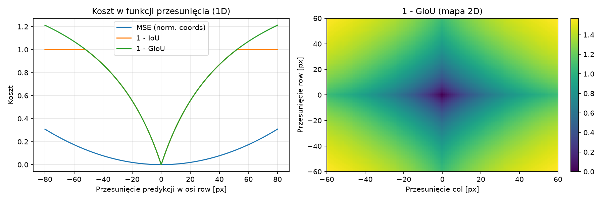{width=92%}

## 5. Trening na emoji

Ustawienia jak w ćwiczeniu: 10 epok, 64 kroki na epokę, batch 64, Adam $10^{-3}$, early stopping (3 epoki bez poprawy IoU wal.).

| Przebieg | box_weight | Najlepsza epoka | IoU wal. | Komentarz |
|---|---:|---:|---:|---|
| baseline | 1 | 1 | 0,642 | Stop w 4. epoce; później accuracy rośnie, ale IoU wal. już spada |
| w10 | 10 | 8 | 0,749 | Box siedzi wyraźnie stabilniej |

Przy baseline pierwsza epoka dała najlepsze IoU walidacyjne, a potem sieć bardziej uczyła się rozpoznawać klasę niż trzymać box — przy takim generatorze to nie dziwiło. Po podbiciu wagi MSE (`w10`) IoU na walidacji doszło do 0,75, kosztem wolniejszej klasyfikacji (accuracy wal. końcowo ok. 29%).

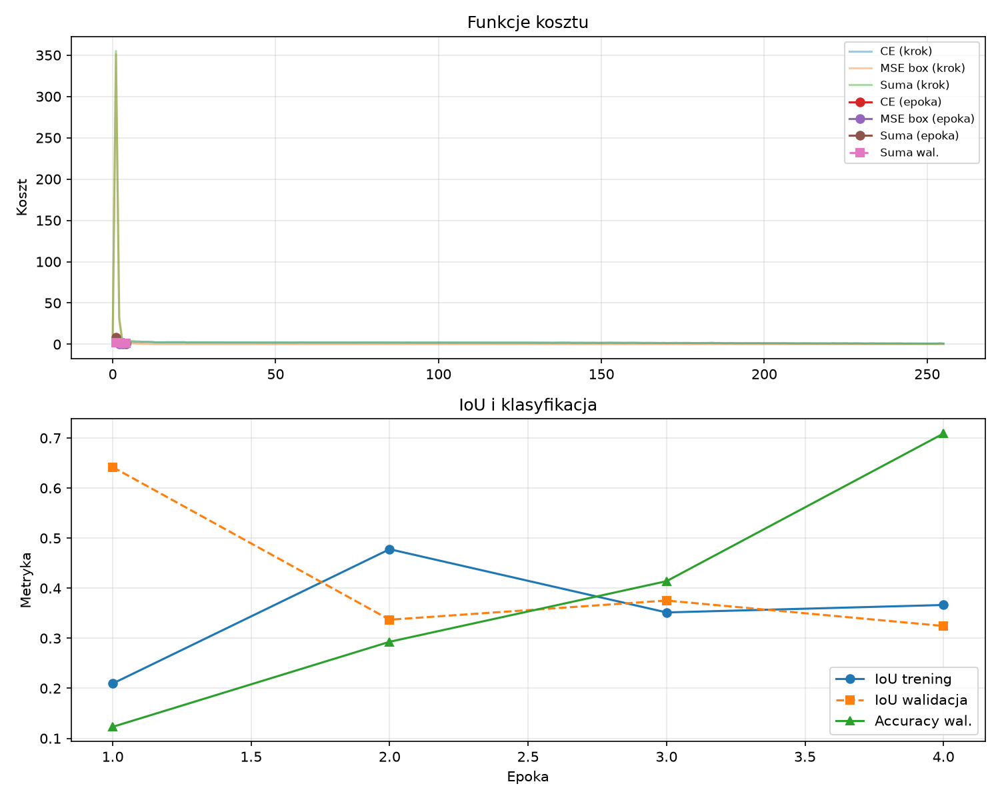{width=92%}

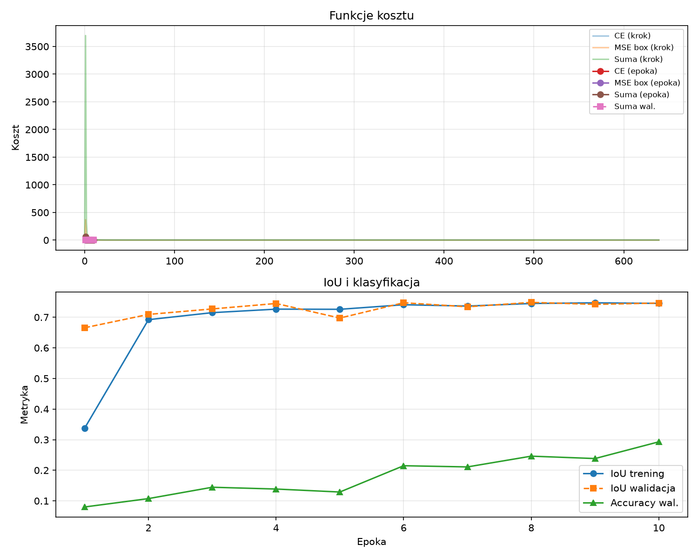{width=92%}

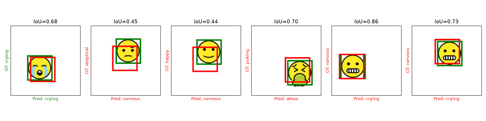{width=92%}

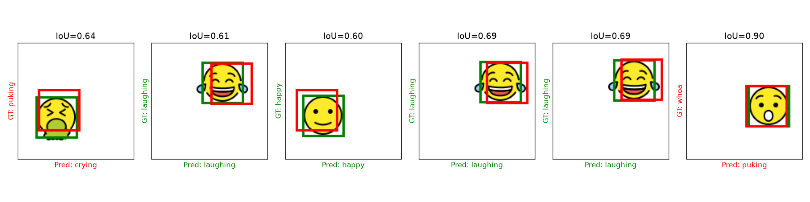{width=92%}

## 6. Test na `emojis/test/`

Skrypt `Object_Localization_test.py` wczytuje zapisany model i dla każdego pliku testowego generuje 100 losowych ułożeń na płótnie (łącznie 600 próbek).

| Model | Śr. IoU | Mediana | IoU >= 0,5 | IoU >= 0,75 |
|---|---:|---:|---:|---:|
| baseline | 0,656 | 0,661 | 82,5% | 29,5% |
| w10 | 0,787 | 0,794 | 99,7% | 66,7% |

Na emoji niewidzianych w treningu IoU nadal jest sensowne (0,65 / 0,78), ale klasyfikacja się myli — model musi wcisnąć nową buźkę w jedną z 9 znanych klas. Dla `1F62F` (znana klasa) accuracy wyszło tylko 13% przy w10, więc sama lokalizacja na tym zadaniu wyszła lepiej niż rozpoznanie.

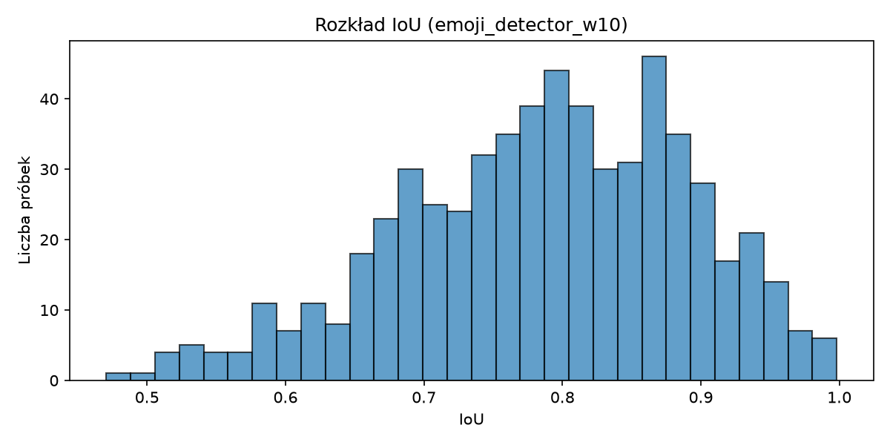{width=65%}

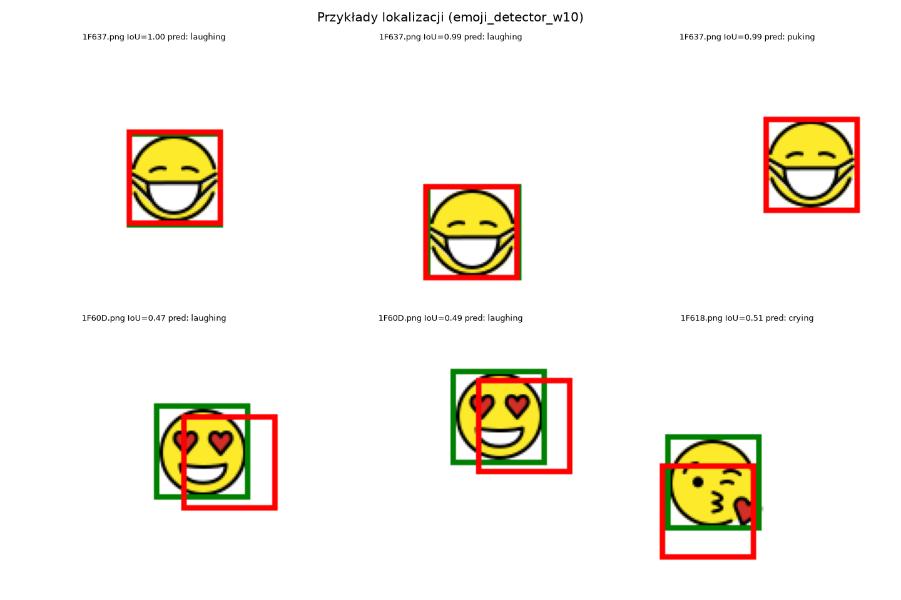{width=92%}

## 7. YOLO na nagraniu z Go2

W `out_/imgs/` jest 402 klatki 424$\times$240 z pokładowej kamery; do tego `depth16/` (16-bit). Obraz jest z dołu, często widać tylko nogi albo fragment biura, sporo kadrów jest rozmytych przez ruch.

Odpaliłem YOLO26n/s/m-pose (Ultralytics 8.4), conf=0,25. Żeby nie liczyć metryk „na oko” na całym filmie, co dziesiątą klatkę (41 sztuk) opisałem ręcznie w `results/yolo/manual_labels.csv` (czy jest osoba, co widać, czy rozmycie) — siatkę podglądową widać na rysunku poniżej.

| Model | Detekcja na 402 klatkach | Śr. conf. | Prec. / recall (41 klatek GT) |
|---|---:|---:|---|
| n | 351 | 0,79 | 1,00 / 0,90 |
| s | 353 | 0,81 | 1,00 / 0,90 |
| m | 350 | 0,83 | 1,00 / 0,90 |

Na ręcznie oznaczonych kadrach bez osoby (np. 90, 100) żaden wariant nie zgłosił fałszywego detektu. Mediana głębi przy widocznych biodrach/nogach to ok. 1,3 m (wartości w PNG są w mm).

Szybkość (30 klatek po rozgrzaniu): na CPU wygrywa n (~36 FPS), na GPU sensownie wypadają s i m (~46 i ~43 FPS). n na GPU wyszło paradoksalnie wolniej (~29 FPS) — przy tak małym modelu pewnie przeszkadza koszt przerzucania danych, nie sam inference.

To się zgrywa z tym, co pisałem w lab. 1: niska kamera = często widać tylko nogi, szkielet bywa niepełny, ale sam detektor osoby nadal coś zwraca. Głębia pomaga podać odległość, choć przy rozmyciu i małej liczbie stawów warto jej nie traktować zbyt dosłownie.

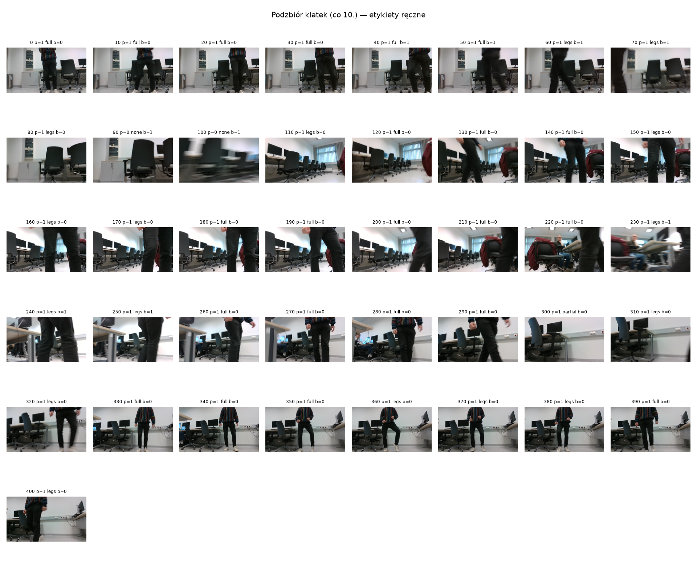{width=92%}

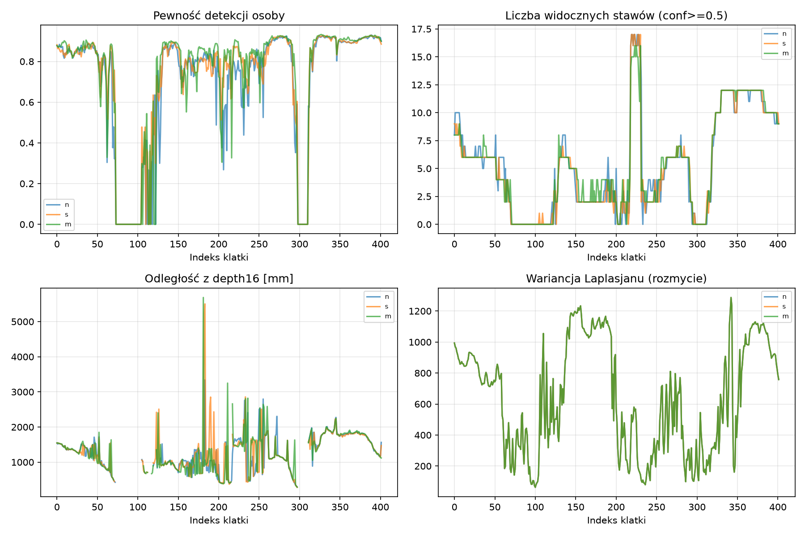{width=92%}

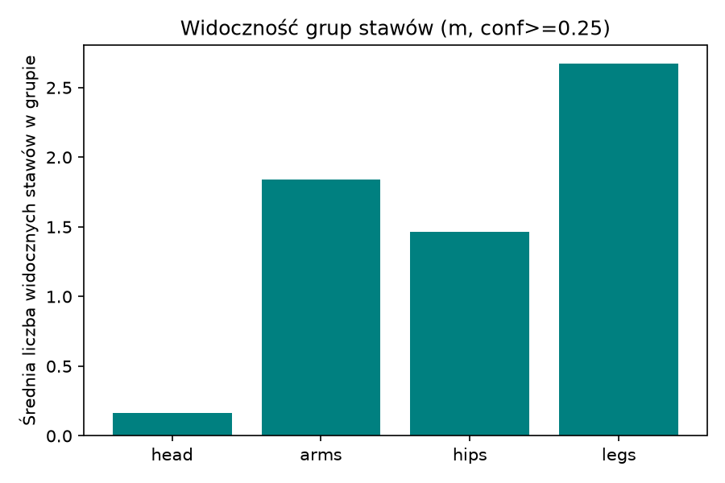{width=65%}

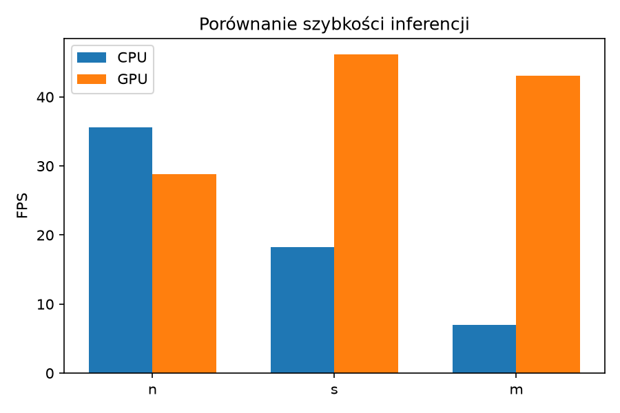{width=65%}

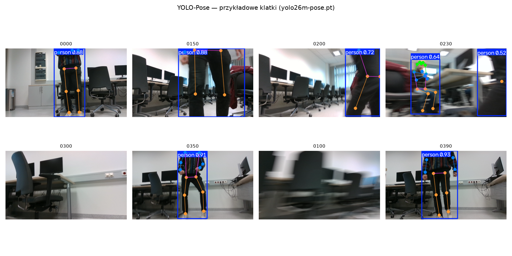{width=92%}

## 8. Wnioski

Zadanie z ćwiczenia (wykresy kosztu, IoU, zapis modelu, test po wczytaniu wag) da się odtworzyć bez grzebania w oryginalnym pliku przy każdym uruchomieniu. Największa różnica na emoji zrobiła waga lossu na boxie — bez tego IoU na walidacji utknął po pierwszej epoce.

Na nagraniu z Go2 YOLO trzyma się całkiem dobrze przy częściowych sylwetkach; słabsze są klatki mocno rozmyte (stąd recall 0,9 na moim małym GT, nie 1,0). Gdybym to wdrażał na Jetsonie, wziąłbym chyba wariant s i dorzucił głębię z D435 tak jak w poprzednim sprawozdaniu.

## Literatura

1. Materiały z ćwiczenia (`task`, `Object_Localization_with_pytorch.py`).
2. J. Redmon i in., YOLO, CVPR 2016.
3. Dokumentacja Ultralytics (YOLO-Pose).
4. Własne sprawozdanie z lab. 1 (Go2, niska kamera, YOLO vs MediaPipe).
